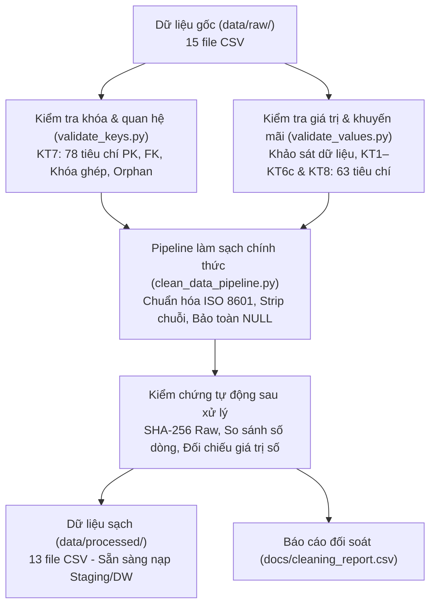

# XÂY DỰNG KHO DỮ LIỆU VÀ HỆ THỐNG HỖ TRỢ RA QUYẾT ĐỊNH BÁN HÀNG THỜI TRANG
*(Fashion Data Warehouse & Decision Support System)*

---

## 1. GIỚI THIỆU DỰ ÁN

Dự án **Fashion_DW_Project** được xây dựng nhằm thiết kế và triển khai một hệ thống Kho dữ liệu (Data Warehouse) hiện đại, phục vụ phân tích đa chiều và hỗ trợ ra quyết định trong hoạt động kinh doanh bán lẻ thời trang. 

Hệ thống tập trung giải quyết các bài toán phân tích chiến lược và vận hành:
* **Hiệu quả bán hàng & Doanh thu**: Phân tích xu hướng doanh thu, biên lợi nhuận, chiết khấu và hiệu quả đơn hàng theo thời gian, kênh bán hàng và khu vực địa lý.
* **Hành vi khách hàng**: Phân khúc khách hàng theo nhân khẩu học, kênh tiếp cận, vòng đời mua sắm và tỷ lệ quay lại.
* **Hiệu suất sản phẩm & Tồn kho**: Đánh giá các dòng sản phẩm bán chạy/chậm, vòng quay tồn kho (sell-through rate), ngày cung ứng (days of supply) và tối ưu hóa chính sách nhập hàng.
* **Đánh giá chương trình khuyến mãi**: Đo lường tác động của các chiến dịch giảm giá, tính chất cộng dồn (stackable) và tỷ lệ áp dụng mã ưu đãi.
* **Chất lượng dịch vụ & Trả hàng**: Phân tích tỷ lệ hủy đơn, trả hàng (returns), lý do trả và mức độ hài lòng qua đánh giá (reviews).

---

## 2. CẤU TRÚC THƯ MỤC DỰ ÁN

Cấu trúc thư mục thực tế của dự án sau khi tối ưu và tinh gọn:

```text
Fashion_DW_Project/
├── .gitignore                  # Cấu hình loại trừ file tạm, cache và dữ liệu lớn
├── README.md                   # Tài liệu tổng quan dự án
├── data/
│   ├── raw/                    # Chứa 15 file CSV dữ liệu nguồn ban đầu (read-only)
│   │   └── .gitkeep
│   └── processed/              # Chứa 13 file CSV nghiệp vụ sạch đã qua pipeline chuẩn hóa
│       └── .gitkeep
├── docs/                       # 6 báo cáo kiểm tra chất lượng và kết quả làm sạch chính thức
│   ├── cleaning_report.csv                 # Thống kê trước/sau làm sạch dữ liệu
│   ├── key_validation_issues.csv           # Chi tiết các bản ghi cần lưu ý về khóa (16 cặp trùng lặp)
│   ├── key_validation_report.csv           # Báo cáo kiểm tra toàn vẹn khóa PK/FK (78 tiêu chí KT7)
│   ├── promotion_category_summary.csv      # Báo cáo tổng hợp khuyến mãi theo danh mục (10 chương trình KT6c)
│   ├── value_validation_issues.csv         # Chi tiết các trường hợp nghi vấn giá trị (882 dòng)
│   └── value_validation_report.csv         # Báo cáo kiểm tra kiểu dữ liệu & giá trị (63 tiêu chí KT8)
└── src/                        # 3 module Python tinh gọn kiểm tra chất lượng và làm sạch
    ├── validate_keys.py        # Kiểm tra khóa chính, khóa ngoại, quan hệ thực thể (KT7)
    ├── validate_values.py      # Khảo sát dữ liệu, kiểm tra khuyến mãi (KT1–KT6c), kiểu dữ liệu & nghiệp vụ (KT8)
    └── clean_data_pipeline.py  # Pipeline làm sạch, chuẩn hóa và kiểm chứng tự động
```

---

## 3. CHỨC NĂNG TỪNG MODULE PYTHON (`src/`)

Các chương trình Python được tổ chức thành 3 module chuyên biệt, loại bỏ hoàn toàn mã trùng lặp:

| Tên file | Bước kiểm tra | Chức năng chi tiết |
|:---|:---:|:---|
| **`validate_keys.py`** | KT7 | Kiểm tra tính toàn vẹn cấu trúc quan hệ: xác định và kiểm tra tính duy nhất của khóa chính (PK); kiểm tra khóa ngoại (FK) tham chiếu bảng cha; phát hiện bản ghi mồ côi (orphan records); phân tích khóa tự nhiên và khóa ghép cho `order_items` (bảo lưu 16 cặp trùng lặp) và `inventory`. Xuất `key_validation_report.csv` và `key_validation_issues.csv`. |
| **`validate_values.py`** | KT1–KT6c & KT8 | **Hợp nhất khảo sát và kiểm tra giá trị**: Khảo sát tổng quan kích thước và tỷ lệ NULL/Duplicate 13 bảng; kiểm tra tính nhất quán khuyến mãi (KT1–KT6c); đối chiếu ngành hàng sản phẩm với điều kiện áp dụng khuyến mãi cho 30.061 lượt giao dịch (KT6c); kiểm tra 63 tiêu chí kiểu dữ liệu, biên giá trị, logic thời gian và phân loại lỗi/nghi vấn nghiệp vụ (KT8). Xuất `value_validation_report.csv`, `value_validation_issues.csv` và `promotion_category_summary.csv`. |
| **`clean_data_pipeline.py`** | Pipeline chuẩn hóa | Đọc 13 tệp CSV nghiệp vụ; chuẩn hóa khoảng trắng chuỗi (`.str.strip()`); xác thực ngày tháng theo chuẩn ISO 8601 (`YYYY-MM-DD`); bảo lưu các trường NULL hợp lệ; xuất dữ liệu sang `data/processed/`; thực thi bộ kiểm chứng toàn diện (SHA-256 raw, số lượng dòng, tính bất biến số tiền) và tạo báo cáo `cleaning_report.csv`. |

---

## 4. DANH SÁCH DỮ LIỆU DỰ ÁN

### 4.1. Bảng dữ liệu nghiệp vụ đưa vào Kho dữ liệu (13 bảng)

Toàn bộ 13 bảng dưới đây đã được làm sạch và lưu tại `data/processed/`:

| STT | Tên tệp CSV | Số dòng | Số cột | Vai trò và ý nghĩa nghiệp vụ |
|:---:|:---|:---:|:---:|:---|
| 1 | `customers.csv` | 121,930 | 7 | Thông tin khách hàng: mã định danh, địa chỉ zip, thành phố, ngày đăng ký, giới tính, nhóm tuổi, kênh tiếp cận. |
| 2 | `geography.csv` | 39,948 | 4 | Danh mục địa lý: mã bưu điện (`zip`), thành phố (`city`), khu vực (`region`), quận/huyện (`district`). |
| 3 | `inventory.csv` | 60,247 | 17 | Ảnh chụp tồn kho định kỳ: sản phẩm, tồn kho thực tế, lượng nhập/xuất, tỷ lệ đáp ứng (`fill_rate`), vòng quay hàng hóa. |
| 4 | `order_items.csv` | 714,669 | 7 | Chi tiết dòng đơn hàng: mã đơn, mã sản phẩm, số lượng mua, đơn giá, số tiền chiết khấu, mã khuyến mãi chính/phụ. |
| 5 | `orders.csv` | 646,945 | 8 | Thông tin đơn hàng: mã đơn, ngày đặt, mã khách hàng, mã bưu cục giao, trạng thái đơn, hình thức thanh toán, thiết bị. |
| 6 | `payments.csv` | 646,945 | 4 | Giao dịch thanh toán: mã đơn hàng, phương thức thanh toán, giá trị thanh toán thực tế, số kỳ trả góp. |
| 7 | `products.csv` | 2,412 | 8 | Danh mục sản phẩm: mã sản phẩm, tên, danh mục (`category`), phân khúc (`segment`), kích cỡ, màu sắc, giá bán, giá vốn. |
| 8 | `promotions.csv` | 50 | 10 | Chương trình ưu đãi: mã khuyến mãi, tên, loại giảm giá (%), giá trị giảm, ngày bắt đầu/kết thúc, danh mục áp dụng, cờ cộng dồn. |
| 9 | `returns.csv` | 39,939 | 7 | Nhật ký trả hàng: mã trả hàng, mã đơn, mã sản phẩm, ngày trả, lý do trả, số lượng trả, số tiền hoàn. |
| 10 | `reviews.csv` | 113,551 | 7 | Đánh giá từ khách hàng: mã đánh giá, mã đơn, mã sản phẩm, mã khách hàng, ngày đánh giá, số sao chấm (1–5 sao), tiêu đề. |
| 11 | `sales.csv` | 3,833 | 3 | Báo cáo doanh số tổng hợp theo chuỗi thời gian: ngày (`Date`), tổng doanh thu (`Revenue`), tổng giá vốn (`COGS`). |
| 12 | `shipments.csv` | 566,067 | 4 | Nhật ký vận chuyển: mã đơn hàng, ngày gửi hàng (`ship_date`), ngày giao thành công (`delivery_date`), cước vận chuyển. |
| 13 | `web_traffic.csv` | 3,652 | 7 | Lưu lượng truy cập website: ngày, lượt truy cập (`sessions`), khách duy nhất, số trang xem, tỷ lệ thoát, nguồn truy cập. |

### 4.2. Các tệp dữ liệu không thuộc phạm vi Kho dữ liệu (Tách riêng)

* **`sample_submission.csv`** (548 dòng) và **`submission_idea42_alphaequal.csv`** (548 dòng): Đây là các tệp định dạng nộp bài dự báo Machine Learning. Chúng không chứa thông tin giao dịch kinh doanh thực tế nên được cấu hình loại trừ hoàn toàn, không đưa vào kho dữ liệu bán hàng.

---

## 5. QUY TRÌNH XỬ LÝ VÀ CHUẨN HÓA DỮ LIỆU



Các nguyên tắc làm sạch và bảo toàn nghiệp vụ đã áp dụng:
1. **Bảo tồn tuyệt đối dữ liệu gốc**: Toàn bộ tệp trong `data/raw/` là chỉ đọc (read-only), giữ nguyên 100% mã băm SHA-256.
2. **Chuẩn hóa chuỗi và ngày tháng**: Cắt bỏ khoảng trắng đầu/cuối chuỗi; ngày tháng xác thực định dạng ISO 8601 (`YYYY-MM-DD`).
3. **Bảo lưu giá trị NULL có ý nghĩa**: Giữ nguyên `NULL` tại `promo_id`, `promo_id_2` (đơn không dùng khuyến mãi) và `applicable_category` (khuyến mãi áp dụng toàn sàn). Không tự ý điền 0 hoặc chuỗi mặc định.
4. **Bảo lưu chi tiết đơn hàng**: Giữ nguyên 32 dòng (16 cặp `order_id, product_id`) trong `order_items` vì đây là các dòng mua hàng hợp lệ với đơn giá hoặc mã khuyến mãi riêng biệt.
5. **Bảo lưu các dữ liệu nghi vấn để phân tích**:
   - 477,453 đơn hàng có `order_date < signup_date` (đặc trưng do `signup_date` là ngày cập nhật tài khoản/chương trình thành viên).
   - 130 sản phẩm có biên lợi nhuận thấp (< 5%).
   - 805 chuyến hàng miễn phí vận chuyển (`shipping_fee = 0`).
   - 382 ngày có `COGS > Revenue` (bán lỗ theo ngày).
   - Tồn kho có `reorder_flag` luôn bằng 0.

---

## 6. KẾT QUẢ NGHIỆM THU CHẤT LƯỢNG DỮ LIỆU

* **Số bảng nghiệp vụ đã xử lý**: **13 bảng**.
* **Tổng số bản ghi đầu vào (Raw)**: **2,960,188 bản ghi**.
* **Tổng số bản ghi đầu ra (Processed)**: **2,960,188 bản ghi**.
* **Tỷ lệ bảo toàn dữ liệu**: **100.000%**.
* **Số bản ghi bị cách ly / loại bỏ**: **0 bản ghi**.
* **Đối soát trả hàng `RET-043492`**: Khi đối chiếu theo cặp `(order_id = 698128, product_id = 1009)`, khách mua 5 sản phẩm (chia làm 2 dòng đơn) và trả 3 sản phẩm ($\le 5$). Đây là giao dịch hợp lệ, vi phạm là 0.
* **Toàn vẹn số học**: Tổng số tiền thanh toán, doanh thu, giá vốn, số lượng hàng mua và số tiền hoàn trả khớp chính xác tuyệt đối giữa `raw` và `processed`.
* **Trạng thái hệ thống**: Toàn bộ 13 tệp CSV sạch trong `data/processed/` đã sẵn sàng để chuyển sang giai đoạn thiết kế mô hình chiều và ETL vào SQL Server.

---

## 7. HƯỚNG DẪN CHẠY CHƯƠNG TRÌNH

### Yêu cầu môi trường
* **Hệ điều hành**: Windows / macOS / Linux.
* **Python**: Phiên bản `3.9` trở lên (đã kiểm thử tương thích tốt trên Python 3.10+ / 3.12).
* **Thư viện phụ thuộc**: `pandas`, `numpy`.

Cài đặt thư viện:
```bash
pip install pandas numpy
```

### Các lệnh thực thi tuần tự (chạy từ thư mục gốc dự án)

1. **Kiểm tra tính toàn vẹn khóa chính và khóa ngoại quan hệ (KT7)**:
   ```bash
   python src/validate_keys.py
   ```
   *Kết quả xuất ra*: `docs/key_validation_report.csv`, `docs/key_validation_issues.csv`.

2. **Khảo sát dữ liệu, kiểm tra khuyến mãi (KT1–KT6c) và kiểm tra giá trị/nghiệp vụ (KT8)**:
   ```bash
   python src/validate_values.py
   ```
   *Kết quả xuất ra*: `docs/value_validation_report.csv`, `docs/value_validation_issues.csv`, `docs/promotion_category_summary.csv`.

3. **Chạy pipeline chuẩn hóa và xuất dữ liệu sạch sang `data/processed/`**:
   ```bash
   python src/clean_data_pipeline.py
   ```
   *Kết quả xuất ra*: 13 tệp CSV tại `data/processed/` và báo cáo kiểm chứng `docs/cleaning_report.csv`.

---

## 8. TIẾN ĐỘ DỰ ÁN

| Hạng mục công việc | Trạng thái | Ghi chú |
|:---|:---:|:---|
| **1. Khảo sát dữ liệu nguồn (KT1 - KT6c)** | Hoàn thành | Đã xác định đặc điểm NULL, Duplicate và logic khuyến mãi |
| **2. Kiểm tra toàn vẹn khóa PK/FK (KT7)** | Hoàn thành | Xác nhận 100% tính toàn vẹn quan hệ giữa các bảng |
| **3. Kiểm tra kiểu dữ liệu & bất thường (KT8)** | Hoàn thành | Xác thực 63 tiêu chí chất lượng giá trị |
| **4. Pipeline chuẩn hóa & làm sạch dữ liệu** | Hoàn thành | Đã xuất 13 bảng sạch sang `data/processed/` (2.96M dòng) |
| **5. Thiết kế mô hình chiều (Dimensional Modeling)** | Kế hoạch tiếp theo | Thiết kế Star Schema, Fact tables, Dimension tables |
| **6. Thiết kế khóa thay thế (Surrogate Keys)** | Kế hoạch tiếp theo | Định nghĩa surrogate keys cho ETL Data Warehouse |
| **7. Cài đặt CSDL Kho dữ liệu (SQL Server)** | Kế hoạch tiếp theo | Tạo Database, Schema (Staging, EDW, Data Marts) |
| **8. Xây dựng quy trình ETL/ELT tự động** | Kế hoạch tiếp theo | Nạp dữ liệu từ Staging vào Fact và Dimension |
| **9. Xây dựng Báo cáo & Dashboard phân tích** | Kế hoạch tiếp theo | Thiết kế Dashboard tương tác hỗ trợ ra quyết định (Power BI) |

---

## 9. LƯU Ý VỀ DỮ LIỆU TRÊN GITHUB

* Các tệp CSV trong hai thư mục `data/raw/` và `data/processed/` có kích thước lớn (tổng dung lượng > 120 MB) nên đã được cấu hình bỏ qua trong `.gitignore` để tuân thủ quy định và khuyến nghị về kích thước repository của GitHub.
* Hai thư mục này được duy trì cấu trúc trên Git thông qua tệp `.gitkeep`.
* Người sử dụng hoặc người đánh giá khi clone dự án về máy tính cần tải bộ dữ liệu nguồn và đặt vào thư mục `data/raw/`, sau đó chạy lệnh `python src/clean_data_pipeline.py` để sinh ra toàn bộ 13 tệp dữ liệu sạch trong `data/processed/`.
